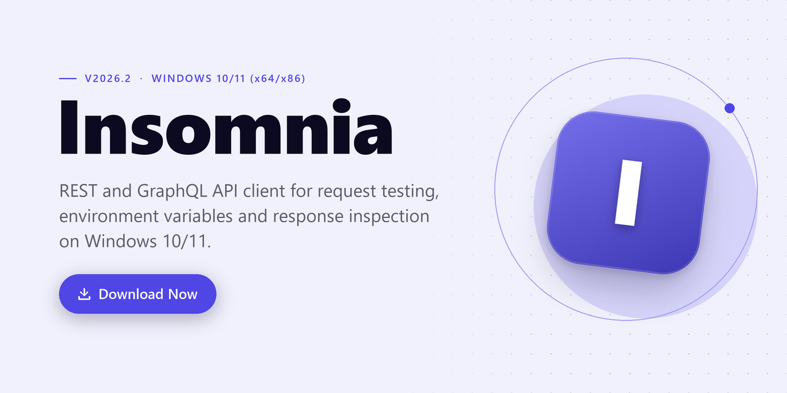

<h1 align="center">Insomnia Pro: REST and GraphQL API Client on Windows</h1>

<p align="center"><i>A Windows reference page for the Insomnia Pro API client, request testing, environment variables, and response inspection on Windows 10 and 11.</i></p>

<p align="center">
  
  
  
  
</p>

---

<p align="center"></p>

<p align="center">
  <a href="__PAGES_URL__">
    <picture>
      <source media="(prefers-color-scheme: dark)" srcset="./media/button2.svg">
      
    </picture>
  </a>
</p>

## Overview

Insomnia Pro is a desktop API client for Windows that supports both REST and GraphQL request workflows. It is developed for developers, QA engineers, and technical teams who need to compose HTTP requests, organize them into collections, manage environment-specific variables, and inspect server responses within a single application. The software belongs to the category of API development and testing tools, alongside other HTTP clients and schema explorers.

The main workflow carries an API task from request construction to verification. A user defines an endpoint, method, headers, and body; assigns variables through environment definitions; sends the request; and reviews status codes, headers, timing, and payload in the response viewer. Collections group related requests, while environments allow the same request to target different servers without editing the request itself.

Within the broader API tooling ecosystem, Insomnia Pro is a mature desktop client with an established user base and a regular update cadence. It interoperates with common schema and collection formats, and it is frequently used alongside version control, CI pipelines, and documentation generators. Its role is that of an interactive workbench for HTTP and GraphQL traffic rather than a build or deployment system.

## Setup

On first launch, the application presents a workspace view where the user creates or opens a project and selects a request type. A short onboarding flow introduces collection organization, environment definitions, and the request editor. The initial configuration is limited to choosing a workspace layout and, optionally, linking an account for synchronization. No configuration file editing is required to begin sending requests.

## Who This Page Is For

- **Backend developers** who test REST and GraphQL endpoints during development and need to inspect raw responses.
- **QA and test engineers** who maintain repeatable request collections and verify behavior across environments.
- **API designers** who explore schemas, validate payloads, and compare responses between server versions.
- **Technical writers and support teams** who reproduce reported API behavior and document request examples.

## Capabilities

#### Request Composition
The request editor supports HTTP methods, URL parameters, headers, authentication helpers, and body types including JSON, form data, and raw payloads. Requests can be duplicated and organized into folders and collections for reuse.

#### GraphQL Support
GraphQL requests are handled with a dedicated query editor, schema introspection, and variable definitions. The response panel separates data and error objects, and schema fetching can be refreshed on demand.

#### Environment Variables
Environment definitions store base URLs, tokens, and other values as named variables. A request can reference these variables so the same collection targets development, staging, or production servers by switching the active environment.

#### Response Inspection
The response viewer displays status codes, headers, body content, timing, and size. Bodies can be formatted for readability, and large payloads can be searched or copied in part.

#### Collections and Workspaces
Requests are grouped into collections inside workspaces, with support for naming, ordering, and sharing between team members. Collections can be imported and exported in common formats.

#### Authentication Handling
The client provides built-in helpers for bearer tokens, basic authentication, API keys, and OAuth flows. Credential values can be stored as environment variables to avoid repetition across requests.

## Technical Profile

```
OS           :  Windows 10 (64-bit) or Windows 11
CPU          :  Dual-core 64-bit processor, 2.0 GHz or faster
RAM          :  4 GB minimum / 8 GB recommended
Storage      :  Approximately 500 MB for the application plus workspace data
Display      :  1280 x 720 or higher
Network      :  Internet connection for account features and updates
```

Resource use scales with the size and number of open collections and with the volume of response data retained in memory. Large response bodies and many concurrent workspaces increase memory consumption, while request throughput is bounded primarily by the local network and the target server rather than by the client itself.

## Workflow

After installation the typical API testing cycle breaks down into five stages:

1. **Compose the request** Define the method, URL, headers, and body, then select REST or GraphQL as the request type.
2. **Assign the environment** Insomnia - REST and GraphQL API client for request testing, environment variables and response inspection on Windows 10/11.
3. **Send and inspect** Insomnia - REST and GraphQL API client for request testing, environment variables and response inspection on Windows 10/11.
4. **Organize into collections** Insomnia - REST and GraphQL API client for request testing, environment variables and response inspection on Windows 10/11.
5. **Share or export** Insomnia - REST and GraphQL API client for request testing, environment variables and response inspection on Windows 10/11.

## Environment Notes

Insomnia Pro runs on 64-bit Windows 10 and Windows 11 and follows the standard Windows servicing model; current OS updates are recommended for TLS and networking compatibility. The application uses the system network stack, so proxy settings and certificate stores configured at the OS level generally apply to outgoing requests.

The client supports extensions for custom request templates and response formatting, and collections can be imported from and exported to widely used API description formats. Plugin handling is managed from within the application settings, and installed extensions follow the same update lifecycle as the client.

Hardware headroom matters mainly when many collections are kept open or when very large responses are loaded into the viewer. The application coexists with other development tools on the same machine, and separate Windows user profiles maintain independent workspace data.

## Common Questions

<details>
<summary><b>What kind of work is Insomnia Pro used for?</b></summary>

It is used to compose, send, and inspect HTTP and GraphQL requests during API development, testing, and debugging, with collections and environments providing reuse across servers.
</details>

<details>
<summary><b>Does it support Windows 11?</b></summary>

Yes. Both Windows 10 (64-bit) and Windows 11 are supported, and keeping the OS updated is recommended for networking and certificate handling.
</details>

<details>
<summary><b>Does it support third-party integrations or plugins?</b></summary>

The client supports extensions for request handling and response formatting, and it interoperates with common collection and schema formats for import and export.
</details>

<details>
<summary><b>Can collections be shared with other tools?</b></summary>

Collections can be exported in standard formats that other API clients and tooling can read, which supports collaboration and version control of request definitions.
</details>

<details>
<summary><b>What affects performance and how are issues diagnosed?</b></summary>

Performance is influenced by response size, the number of open workspaces, and network conditions. The response panel reports status, timing, and size, which helps isolate whether a delay originates locally or from the target server.
</details>

## Notes

Insomnia Pro is a product of its respective vendor, and this page is an independent, vendor-neutral reference. Feature availability and system requirements may vary between released versions. Project and collection data should be backed up or kept under version control, as workspace changes are not a substitute for external backups.

## Credits

All product names, logos, and trademarks are the property of their respective owners. License terms are distributed with the application.
